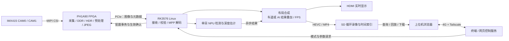

# 2026 年嵌赛 · FPGA 创新赛道 · 安路赛题三

## FPGA + RK3576 异构图像处理与边缘 AI 系统

本仓库保存本工程的最终 FPGA 工程、RK3576 软件复现包和配套开发工具。系统以安路 **PH1A90SEG324-2 FPGA** 与 **RK3576** 为核心，接入 IMX415 相机：FPGA 完成图像采集、DDR 缓存、HDR、图像预处理和 JPEG 编码，经 PCIe 传输至 RK；RK 完成解码、显示合成、单目 AI 推理、SD 循环录像及 4G 远程控制。

当前完成联合调试的复现组合为 **`final_basic · 1a5603c1 · seed25` + `final_rk` V5**。仓库同时保留高分辨率/高帧率融合候选工程，其验证状态与基础版分别说明。

## 仓库内容与版本

| 目录 | 内容 | 使用状态 |
|---|---|---|
| [final_fpga/final_basic](final_fpga/final_basic/README.md) | 1080P 基础版 RTL、IP、约束、TD 工程、seed25 bit 和调试资料 | 与当前 RK 复现包匹配；后续 RK 侧已有单目、双目板测反馈 |
| [final_fpga/final_high_fps](final_fpga/final_high_fps/README.md) | 4K、高帧率、白平衡、Tone 和 HDR 融合预设的候选工程 | `camera_fusion_r1 · 43dbc3f1 · seed54`；时序未收敛，未完成板测 |
| [final_fpga/final_server](final_fpga/final_server/README.md) | TD 自动化构建控制器，支持任务队列、多种子实现、检查点接续、资源准入和产物回传 | 开发工具；需另行配置服务器、TD 和许可证环境 |
| [final_fpga/final_agents](final_fpga/final_agents/README.md) | 开发中使用的 Skills、MATLAB/Visio MCP 配置和参考资源 | 可选辅助工具 |
| [final_rk](final_rk/README.md) | RK3576 完整软件复现包、精简源码包、说明及 SHA-256 校验文件 | 当前基础版的软件交付入口 |

`final_rk` 提供两个包：

- [完整复现包](final_rk/final-basic-seed25-repro.tar.gz)：包含程序、匹配 bit、已验驱动、模型、私有依赖和详细操作说明，供原 RK3576 BSP 环境复现。
- [精简源码包](final_rk/final-basic-seed25-source-minimal_20261112.zip)：包含控制、显示、录像、AI、驱动及对应原生库源码和必要说明，供阅读与维护。

当前 RK 完整包针对 `final_basic`，尚未适配 `final_high_fps` 新增的全部接口与参数。两套 FPGA 工程的源码、IP 和约束独立使用。

## 系统数据流



实时画面在 HDMI 输出，浏览器用于模式、布局、参数控制及已保存录像的查询回放。录像分支取自最终显示合成画面，包含 FPS 以及相应的车道/AI 叠加。

FPGA 还提供独立的未压缩 RAW10 输出路径。RAW 接收核验与 JPEG 显示是不同工作路径，当前尚未完成 RAW 经 RK ISP 处理后显示的完整链路。

## 基础版已实现的主要功能

| 功能 | 单目 CAM0 | 双目 CAM0 + CAM1 |
|---|---|---|
| 图像分辨率 | 1920 × 1080 | 每眼 1920 × 1080 |
| SDR 目标帧率 | 60 FPS | 每眼 30 FPS |
| HDR 目标帧率 | 30 FPS | 每眼 30 FPS |
| FPGA 图像处理 | 彩色透传、灰度、高斯滤波、直方图均衡化、去雾、HDR | 彩色透传、灰度、高斯滤波、直方图均衡化、去雾、HDR |
| 车道识别 | 接收 FPGA 车道信息，在 RK 绘制曲线叠加 | 当前不开放 |
| AI 检测与测距 | RK 本地运行 YOLO，叠加检测框、类别和估计距离 | 当前不开放 |
| HDMI 布局 | CAM0 全屏 | 左右同屏、CAM0 全屏、CAM1 全屏 |
| FPS 显示 | CAM0 动态 FPS | 逐眼动态 FPS |
| 在线参数 | 按实际能力开放 HDR、ISP、JPEG 参数 | 按双目实际能力开放适用参数；固定字段只读 |
| 操作入口 | RK 终端菜单，或 4G/Tailscale 网页 | RK 终端菜单，或 4G/Tailscale 网页 |
| SD 录像 | 最终显示画面循环录像、时间查询、回放和下载 | 同样记录最终布局与叠加结果 |

应用通过唯一的接收与配置控制进程访问硬件。参数初值读取 ACTIVE 或使用已确认策略；修改保留其他配置，串行提交，等待 FPGA 的 APPLIED 和对应新画面后确认完成。数值项、开关和枚举的范围由当前 bit 的能力及实际活动配置决定，不把未开放字段作为可调参数。

网页与终端不设总运行时长、总操作次数限制；每笔硬件事务仍有超时与故障保护。离线模式仅通过终端操作；联网前要求操作者确认电脑已加入同一 Tailscale 网络。V5 的联网顺序为：**4G 数据连接 → 两个独立 NTP 参考校时 → 严格 HTTPS 检查 → Tailscale → 视频与录像**。

上述帧率为目标值。实际结果受算法组合、JPEG 质量、画面内容和主机负载影响，配置/HDR 暖机时间应单独考虑；输入完整产品统计、HDMI 叠加 FPS 和实际显示效果应结合判断。

## 开发板、外设与软件环境

| 项目 | 本工程使用的硬件或环境 |
|---|---|
| RK 开发平台 | 米联客 MLK-AFH03-AFC03，AFC03 核心板与 AFH03 底板，RK3576 |
| FPGA 器件 | 安路 PH1A90SEG324-2；TD 工程顶层为 `anlogic2026` |
| 相机 | IMX415，支持 CAM0/CAM1 两路；项目使用过 MLK-CAM002-IMX415 模组资料 |
| 板间传输 | PCIe，用于图像、元数据与控制事务；相机采集位于 FPGA 侧 |
| 显示与存储 | HDMI 显示器、SD 卡 |
| 远程通信 | Quectel EC200A 4G 模块、SIM 与天线；上位机与板卡通过 Tailscale 组网 |
| RK 系统 | 原 Debian 12 / ARM64 BSP，Linux 6.1.99 |
| RK 软件 | Python 3.11、NumPy、OpenCV、SciPy、GI/PyGObject；GStreamer、Rockchip MPP/RGA、RKNN runtime 与 NPU 驱动 |
| FPGA 工具 | TD 2026.2 / 6.2.3.210850 及对应器件支持；历史仿真使用 ModelSim SE-64 2020.4 |
| 开发辅助环境 | Linux 侧使用 Ubuntu 22.04 虚拟机进行源码整理、部署和日志采集；FPGA 静态检查使用 Python 3.12 |
| 可选构建服务器 | TD 自动化控制器 v6.6，Python 3.12.9；控制器版本与 TD 编译器版本分别管理 |

完整复现包面向原板卡与已确认 BSP，不包含操作系统镜像。更换内核、板卡、SD 卡或模型时，需要重新核对驱动构建身份、设备与存储配置、模型及原生依赖。

## 子卡 DSI 改 CSI 方案

[MLK-FMC_VID005_MIPI 子卡 DSI 改 CSI 修改方案](MLK-FMC_VID005_MIPI_DSI改CSI修改方案.html)记录了将 FMC 子卡原 DSI 输出接口改作 MIPI CSI 接收接口的硬件修改方案，涵盖子卡和配套底板的电阻、信号网络调整，并附原理图及修改前后实物对照。

文档对应 `MLK-FMC_VID005_MIPI` 子卡 `Ver:20250530` 和 `MLK-AFH03` 底板。HTML 已内嵌图片，下载后用浏览器打开可查看完整图文说明。

## 快速复现入口

1. 阅读 [FPGA 基础版说明](final_fpga/final_basic/README.md)和 [RK 软件说明](final_rk/README.md)，在 `final_rk/` 中使用 `sha256sum -c SHA256SUMS` 核对两个包。
2. 将完整包部署到 RK 的 `/userdata/final-basic-seed25-repro/`。首次解包前确认目标目录不存在；已有安装的更新按包内文档执行。
3. FPGA 与 RK 共同冷启动，仅向 SRAM 下载 [基础版 seed25 bit](final_fpga/final_basic/fpga_prj/bit/camera_raw_r2_1a5603c1_seed25.bit)。保持相机、HDMI、SD 连接；联网测试另接4G模块。
4. 在 RK root 终端执行：

   ```sh
   cd /userdata/final-basic-seed25-repro
   ./reproduce.sh verify
   ./reproduce.sh
   ```

5. 选择本次单目或双目，确认冷启动与资源独占，再选择是否联网。不联网时核对本机日期；联网时先在电脑准备同一 tailnet，再按脚本提示确认。成功后通过终端菜单或脚本打印的网址操作。
6. 停止时执行 `./reproduce.sh stop`，等待显示停止、录像尾段封存。更换本次目数或重新 START，需再次共同冷启动并下载 bit。

双目中的“只看 CAM0 / 只看 CAM1”是 HDMI 布局选择，两眼仍持续接收，不会切成单目采集。详细菜单、参数、依赖与日志位置见完整包内文档；精简源码包用于维护，不作为板端安装包执行。

## 验证状态

| 对象 | 当前可依据的结论 |
|---|---|
| `final_basic` seed25 bit | SHA-256 为 `eee7eff50323a8a5c7ddc850d3873e1dda13473debbfe8a690bcb6bab17ac362`，与 RK 完整包内 bit 一致；在归档约束与报告范围内时序通过，setup 最低余量仅 **+0.001 ns** |
| RK V5 与基础版联合运行 | 已有单目离线及双目4G入口正常反馈；单目已操作算法、YOLO、JPEG Q，以及双目三布局/六算法有相应记录；双目同屏录像样本已确认有实际两眼图像及 FPS，按当天时间查询正常 |
| `final_high_fps` seed54 | 目标包含单目4K15/20、双目1080P30/40/45/48及更多画质参数；随附 bit 的 setup 为 **−0.214 ns**，未收敛，板级为 `NOT_RUN` |

FPGA 归档文档中的 `NOT_RUN`，以及 RK 压缩包内部分“待整包板测”的说明，保留了其交付或封装时的登记状态。本页补充后续 RK 侧同一 seed25 bit 的联合调试结果，不改写原报告，也不将其扩展为全部测试项、全部参数范围或高帧率工程的验收结论。仿真、静态时序、驱动传输、画质和实板显示分别判定。

## 不足与已知缺陷

| 项目 | 当前限制与后续工作 |
|---|---|
| 单目/双目在线切换 | 会话重建曾出现排空超时等故障，复现入口已关闭真实目数热切换；目前依靠共同冷启动选择 |
| 时序与资源余量 | 基础版时序余量很小；融合版尚未收敛，Slice/ERAM 占用接近器件上限，仍需优化并重新验证 |
| 高分辨率/高帧率 | 4K 和更高双目速率属于候选能力，不能作为已达成的系统实测性能；当前 RK 完整包未完成对应适配 |
| 录像与回放 | 最新样本和时间查询已验证，但所有历史录像、长期循环回收及回放兼容性尚未全量验收；不合格旧文件可能被回收器跳过并留下告警 |
| AI 精度与同步 | 识别能力和距离标定仍需提高；结果异步叠加，允许滞后，尚未实现严格同帧同步 |
| 报警 | 尚未集成到当前复现入口，源码中的相关辅助模块不代表功能已启用 |
| RAW 后处理 | 当前为未压缩 RAW10 输出及接收核验；RAW→RK ISP→HDMI 链路尚未完成 |
| 画质和长期稳定性 | HDR、不同光照/运动场景、全部参数范围及长时间运行仍缺少系统性量化验收；短时正常反馈不能替代完整可靠性验证 |
| 停止与恢复 | STOP 后底层资源仍按原策略留置，尚不支持同boot安全重新START或故障热恢复 |

## 进一步阅读

- [FPGA 总说明](final_fpga/README.md)：两版工程、工具与资料入口。
- [基础版调试指南](final_fpga/final_basic/fpga_docs/debug_seed25/README.md)与[时序记录](final_fpga/final_basic/fpga_docs/debug_seed25/TIMING_REVIEW.md)。
- [融合版功能矩阵](final_fpga/final_high_fps/fpga_docs/MODE_MATRIX.md)与[bit 状态](final_fpga/final_high_fps/fpga_docs/BITSTREAM_STATUS.md)。
- [RK 最终交付](final_rk/README.md)：完整复现包、精简源码及校验文件。
- [服务器控制器](final_fpga/final_server/README.md)与[开发辅助工具](final_fpga/final_agents/README.md)。

第三方代码、IP、模型和工具的作者信息、许可证及使用条件以各目录和原交付中的声明为准。

整理日期：2026-11-12。
